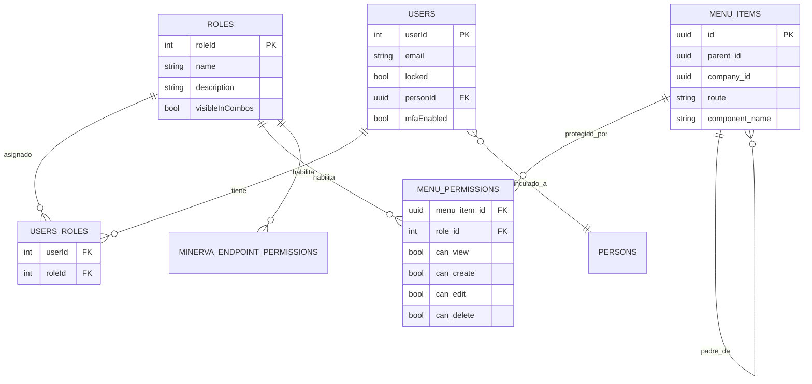
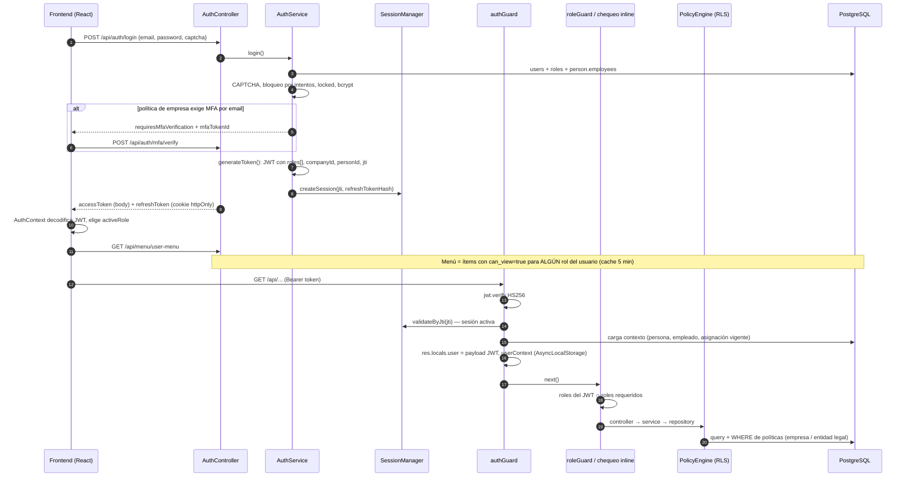

# RBAC en TitanHR — validación de usuario y rol

Relevamiento del control de acceso de TitanHR (repo `Titan_dev/titanHR`, rama `AccessControl`, octubre 2026). Describe cómo se autentica un usuario, de dónde salen sus roles y en qué puntos del sistema esos roles se verifican. Todo lo descripto sale del código y de la BD local. Al final hay una sección de hallazgos.

## Resumen

TitanHR no tiene un RBAC centralizado de tipo "permiso por endpoint". El control de acceso se reparte en **cuatro capas**, y cada una usa los roles de forma distinta:

| Capa | Qué controla | Dónde | Fuente de los roles |
|------|--------------|-------|---------------------|
| 1. Autenticación | Quién es el usuario y si su sesión sigue viva | `authGuard` (backend) | JWT + tabla de sesiones |
| 2. Navegación (menú dinámico) | Qué pantallas ve el usuario | `system.menu_permissions` + `ProtectedRoute` (frontend) | BD (menú) / JWT (frontend) |
| 3. Autorización por endpoint | Qué endpoints puede invocar | `roleGuard([...])` y chequeos inline | JWT (`res.locals.user.roles`) |
| 4. Seguridad de datos (RLS de aplicación) | Qué filas ve (empresa, entidad legal) | `SecurityDataSourceWrapper` + `PolicyEngine` | Grupos de políticas por usuario, **no por rol** |

Los roles son **planos**: no hay jerarquía ni herencia, y los permisos son la unión de todos los roles del usuario.

---

## 1. Modelo de datos



| Tabla | Rol en el RBAC |
|-------|----------------|
| `system.users` | Credenciales, bloqueo (`locked`), MFA, vínculo a `hr.persons` vía `personId` |
| `system.roles` | Catálogo de roles. Se identifican **por nombre** en el código (`'IT'`, `'Manager'`…) |
| `system.users_roles` | N:M usuario ↔ rol |
| `system.menu_items` | Árbol de menú (hasta 5 niveles), opcionalmente por empresa (`company_id` NULL = global) |
| `system.menu_permissions` | Permiso de un rol sobre un ítem de menú. Solo `can_view` se usa en la práctica |
| `system.minerva_endpoint_permissions` | Endpoints que el chatbot Minerva puede invocar en nombre del usuario, por rol |

### Roles existentes (BD local)

| roleId | Nombre | Descripción | Usuarios | Menús visibles |
|-------:|--------|-------------|---------:|---------------:|
| 1 | IT | Dueño de la aplicación (super-admin de facto) | 2 | 193 |
| 3 | Apoderado | Firma digital como apoderado legal | 11 | 1 |
| 6 | Manager | Ver mi equipo de trabajo y solicitudes | 9 | 20 |
| 20 | E_PortalEmpleado | Portal Empleado: perfil, inicio, horario | 544 | 5 |
| 21 | E_GestionDocumental | Recibos y documentos del empleado | 687 | 4 |
| 22 | E_GestionVacacionesLicencias | Vacaciones y licencias | 237 | 4 |
| 23 | E_GestionAdministrativa | Legajo digital, anticipos, objetivos y tareas | 162 | 9 |
| 24–27 | RRHH_E_* | RRHH accediendo a la vista Empleado de cada módulo | 13–22 | 4–9 |
| 28–31 | RRHH_* | Vista RRHH de cada módulo (Portal, Documental, Vacaciones, Administrativa) | 13–24 | 1–29 |
| 32 | RRHH_SeleccionCapacitacion | Desempeño, Plan de Carrera, Reclutamiento | 2 | 22 |
| 33 | NOMINA_GT | Nómina > Gestión de Tiempo | 5 | 37 |
| 34 | NOMINA_LIQ | Nómina > Liquidador | 0 | 12 |
| 35–38 | *GestionSanciones | Mediador / Empleado / RRHH sobre sanciones | 0–3 | 0–6 |
| 39 | RRLL | Relaciones Laborales: bajas y desvinculaciones | 0 | 4 |
| 40 | Interfaz_IT | Solo configuración de interfaces con otros sistemas | 2 | 2 |

Los roles siguen una convención **por módulo y por perspectiva**: `E_<Modulo>` (el empleado sobre sus propios datos), `RRHH_E_<Modulo>` (RRHH viendo la vista de empleado) y `RRHH_<Modulo>` (RRHH administrando). Un usuario típico acumula varios roles.

---

## 2. Flujo completo: login → request autorizado



### 2.1 Login — `backend/src/modules/auth/services/auth.service.ts`

1. Busca el usuario por email con relaciones `roles`, `person`, `person.employees`. La empresa del usuario (`companyId`) se deriva del **empleado activo** (`getActiveEmployee`).
2. Valida CAPTCHA si corresponde (`CaptchaService`), según intentos previos.
3. Verifica bloqueo temporal por intentos fallidos (`LoginAttemptService.getLockStatus`). Si al fallar se alcanza el límite, bloquea la cuenta.
4. `validateUser()`: usuario existe, `locked = false`, `bcrypt.compare` de la contraseña. Aplica expiración de contraseña por política de empresa (fuerza `requirePasswordChange`, no bloquea el login).
5. Si la política efectiva de la empresa tiene `mfaEnabled` con tipo `EMAIL`, corta acá y devuelve un `mfaTokenId`; el login se completa en `/api/auth/mfa/verify` (`completeMfaLogin`).
6. `generateToken()` firma un JWT HS256 con:

   ```json
   {
     "jti": "uuid de sesión",
     "userId": 123, "email": "...", "name": "...",
     "roles": ["E_PortalEmpleado", "E_GestionDocumental", "Manager"],
     "personId": "...", "employeeId": "...", "employeeCode": "...",
     "companyId": "...", "companyName": "...",
     "legalEntityId": "...", "conventionId": "..."
   }
   ```

   Los roles van **por nombre**. La expiración sale de `sessionAbsoluteTimeoutHours` de la política de la empresa (default 24 h).
7. Crea la sesión (`SessionManagerService.createSession`) con el `jti` y el hash SHA-256 del refresh token, y verifica términos legales pendientes.
8. Respuesta: access token en el body; refresh token opaco en cookie httpOnly.

**Refresh** (`POST /api/auth/refresh`): rota el refresh token (detección de reuso → revoca todas las sesiones), relee el usuario de la BD (rechaza si `locked`) y emite un JWT nuevo con los **roles actuales** de la BD.

### 2.2 Validación de cada request — `authGuard`

`backend/src/shared/middleware/auth.guard.ts`. Se aplica **por ruta** en cada controller (no hay guard global en `app.ts`).

| Paso | Falla → |
|------|---------|
| Header `Authorization: Bearer …` presente | 401 `Token no proporcionado` |
| `JWT_SECRET` configurado | 500 |
| `jwt.verify(token, secret, { algorithms: ['HS256'] })` | 403 `Token inválido` |
| Sesión activa por `jti` (o por token completo en sesiones legacy) | 401 `Sesión inválida o expirada` + `reason` |

Si pasa:

- `res.locals.user` = payload del JWT (incluye `roles`), `res.locals.sessionId`.
- Carga desde la BD persona, empleado y **asignación vigente** (`endDate = '7777-07-07'`) y la vuelca en `userContext` (AsyncLocalStorage). Este contexto lo usan la auditoría automática (`createdBy`/`updatedBy`) y el motor de políticas de datos.

> Los **roles** que usa la autorización salen del **JWT**, no de la BD. La sesión sí se valida contra la BD en cada request, así que revocar la sesión corta el acceso al instante. Cambiar los roles de un usuario, en cambio, no tiene efecto en `roleGuard` hasta que se emite un token nuevo (refresh o login).

### 2.3 Autorización por endpoint

Hay tres mecanismos, todos basados en `res.locals.user.roles`:

**a) `roleGuard(roles[])`** — mismo archivo. Pasa si el usuario tiene **al menos uno** de los roles indicados (OR, comparación exacta y sensible a mayúsculas). Si no, 403 `Acceso denegado`. Usos actuales:

| Módulo | Endpoints | Roles |
|--------|-----------|-------|
| `audit-log` | todo el controller | `IT` |
| `email` | envío, configs, logs | `IT` |
| `export-dper` | todo el controller | `IT`, `Interfaz_IT` |
| `motor-hr-v2` | `POST /periods/:periodId/reopen` | `IT` |
| `person-internal-note` | notas internas | `IT`, `RRHH_GestionAdministrativa` |

**b) `personIdGuard()`** — exige que el usuario esté vinculado a una persona (`personId`), necesario para todo lo que es autoservicio del empleado.

**c) Chequeos inline en controllers/services**, por ejemplo:

- `reports.controller.ts` → `checkEmployeeAccess`: pasa si el rol es `IT` o `RRHH`, o si el usuario accede a sus propios datos.
- `survey.controller.ts`, `evaluation/template.controller.ts` → `roles.includes('IT')`.
- `evaluation/score-calculation.service.ts` → `isHRRole()`: match por **substring** (`RRHH`, `HR`, `IT`…).
- `chatbot.service.ts` → `ADMIN` / `Admin`.
- Reglas de negocio que combinan rol y ownership (p. ej. `SanctionDetailPage`: editar solo si es RRHH y no es su propia sanción).

**El resto de los endpoints solo exige `authGuard`**: cualquier usuario autenticado puede invocarlos y la restricción efectiva queda en manos del menú (capa 2) y de las políticas de datos (capa 4).

### 2.4 Menú dinámico y rutas — capa de navegación

**Backend** — `GET /api/menu/user-menu` → `MenuConfigurationService.getUserMenu()`:

1. Relee los roles del usuario **desde la BD** (no del JWT).
2. Trae los ítems raíz activos, globales o de la empresa, que tengan un `menu_permissions` con `can_view = true` para alguno de esos roles.
3. Filtra recursivamente los hijos con el mismo criterio (`filterMenuByPermissions`).
4. Cachea el resultado 5 minutos (`MenuCacheService`, clave `user:<id>:role:<activeRole>:company:<id>`).

El resultado es la **unión** de lo que ven todos los roles del usuario. `can_create`, `can_edit` y `can_delete` existen en la tabla y en el `MenuBuilderPage`, pero ninguna pantalla ni endpoint los aplica.

**Frontend**:

- `AuthContext.js` decodifica el JWT, expone `user.roles` y mantiene un **`activeRole`** en `localStorage` (en mobile prioriza `EMPLEADO`; si no, el primero). El usuario puede cambiarlo desde el layout.
- `DynamicRoutes.js` arma las rutas a partir del menú; cada ruta queda envuelta en `ProtectedRoute` con los roles que tienen `can_view` sobre ese ítem.
- `ProtectedRoute.js`: sin token → `/login`; si la ruta pide roles, pasa si el `activeRole` **o cualquier rol del usuario** está entre los requeridos; con `requirePersonId`, exige `personId`. Varias rutas de detalle se registran con `roles={[]}` ("heredan los permisos del listado"), es decir, sin restricción propia.

> El `activeRole` es una preferencia de UI. No viaja al backend (el JWT no lo trae y `res.locals.user.activeRole` siempre es `undefined`, así que el menú usa `roles[0]` solo como parte de la clave de cache) y no restringe nada: `ProtectedRoute` acepta cualquier rol del usuario.

### 2.5 Seguridad de datos (RLS de aplicación)

Detalle completo en `titanHR/CLAUDE_DATA_SECURITY.md`. Resumen:

- `SecurityDataSourceWrapper` intercepta `getRepository()`; `RepositoryWrapper` envuelve `find`, `findOne`, `findAndCount`, `count` y `createQueryBuilder`.
- `PolicyEngine` carga las políticas del usuario para la entidad (`security.user_policies` + `security_policies` + `user_policy_values`) y `QueryModifier` agrega el `WHERE` correspondiente.
- Las políticas se asignan por **grupos de políticas por usuario** (`security.user_policy_groups`: `COMPANY`, `MULTI_COMPANY`, `SUPER_ADMIN` con `FULL_ACCESS`…), **no por rol**.
- Los parámetros `SELF_company_id` y `legal_entity_ids` se resuelven en cada request con la asignación vigente del `userContext`.
- Cache de políticas: 5 minutos por `userId-entityType-companyId`.
- Las queries crudas (`AppDataSource.query(...)`) **no** pasan por este filtro.

Esta capa responde a *qué filas* ve el usuario; las capas 2 y 3 responden a *qué funciones* puede usar. Son independientes: tener el rol `IT` no da `FULL_ACCESS` a los datos si el usuario no tiene asignado el grupo correspondiente, y viceversa.

---

## 3. Ciclo de vida de un rol

| Acción | Endpoint | Efecto inmediato | Efecto diferido |
|--------|----------|------------------|-----------------|
| Asignar/quitar roles | `PUT /api/users/:id/roles` | `users_roles` actualizado | Menú: al vencer la cache (≤ 5 min). `roleGuard`/inline: al próximo refresh o login |
| Bloquear usuario | `PUT /api/users/:id/lock` | Login rechazado; el refresh revoca todas las sesiones | El access token vigente sigue válido hasta el próximo refresh |
| Revocar sesión / logout-all | `/api/auth/logout*` | `authGuard` rechaza en el siguiente request | — |
| Dar visibilidad de una pantalla a un rol | `POST/PUT /api/menu/admin` | `menu_permissions` actualizado | Menú cacheado hasta 5 min (`/menu/admin/clear-cache` lo fuerza) |
| Crear rol | `POST /api/roles` | Rol disponible en combos (`visibleInCombos`) | Solo hace algo si se le asignan menús o se lo referencia en código |

---

## 4. Hallazgos

Observaciones del relevamiento, ordenadas por impacto. Ninguna se corrigió.

1. **Endpoints de administración de seguridad sin control de rol.** `/api/roles` (alta, edición y baja), `/api/users` (incluido `PUT /:id/roles`, `/:id/password` y `/:id/lock`) y `/api/menu/admin/*` solo exigen `authGuard`. Cualquier usuario autenticado, incluido un empleado con `E_PortalEmpleado`, podría llamar a la API directamente y asignarse `IT`, o darle `can_view` sobre cualquier pantalla a su rol. La protección hoy es solo de UI (el menú no le muestra esas pantallas). **Es el punto más crítico.**
2. **La autorización depende mayoritariamente del menú, que es solo frontend.** Fuera de los ~15 usos de `roleGuard` y algunos chequeos inline, los endpoints no validan rol. `ProtectedRoute` impide navegar, pero no impide invocar la API.
3. **Roles referenciados en código que no existen en la BD.** `reports.controller.ts` chequea `RRHH` y `chatbot.service.ts` chequea `ADMIN`/`Admin`; en `system.roles` no hay roles con esos nombres (los de RRHH son `RRHH_*`). En la práctica, esas ramas solo se activan para `IT`. El `staticMenuItems` de `MobileLayoutDynamic.js` y `AuthContext` siguen buscando `EMPLEADO`, que tampoco existe.
4. **Match por substring en `isHRRole()`.** `role.includes('IT')` también da verdadero para `Interfaz_IT`, y `'HR'` matchea cualquier nombre que contenga esas letras. Frágil ante roles nuevos.
5. **Roles en el JWT con vida de hasta 24 h.** Quitar un rol no se refleja en `roleGuard` hasta el siguiente refresh. Bloquear un usuario tampoco invalida el access token vigente; habría que revocar sus sesiones en el mismo paso.
6. **`can_create` / `can_edit` / `can_delete` sin uso.** El modelo los soporta, pero nadie los aplica: la granularidad real es ver / no ver la pantalla.
7. **`activeRole` no restringe nada.** Da la sensación de que el usuario "opera como" un rol, pero frontend y backend siempre aplican la unión de todos sus roles.
8. **Roles identificados por nombre en el código.** Renombrar un rol en `system.roles` rompe silenciosamente los `roleGuard` y los chequeos inline que lo usan.

## 5. Referencias de código

| Tema | Archivo |
|------|---------|
| Login, JWT, MFA | `backend/src/modules/auth/services/auth.service.ts` |
| Endpoints de auth, refresh con rotación | `backend/src/modules/auth/controllers/auth.controller.ts` |
| `authGuard`, `roleGuard`, `personIdGuard` | `backend/src/shared/middleware/auth.guard.ts` |
| Sesiones | `backend/src/modules/security-auth-policy/services/session-manager.service.ts` |
| Menú por rol | `backend/src/modules/menu/services/menu-configuration.service.ts`, `menu-cache.service.ts` |
| Roles y usuarios | `backend/src/modules/roles/`, `backend/src/modules/users/` |
| RLS de aplicación | `backend/src/security/` (`engine/policy.engine.ts`, `interceptors/*`) |
| Contexto de usuario | `backend/src/userContext.ts` |
| Frontend: sesión y rol activo | `frontend/src/context/AuthContext.js` |
| Frontend: rutas | `frontend/src/components/DynamicRoutes.js`, `ProtectedRoute.js` |
| Documentación existente | `CLAUDE_AUTH.md`, `CLAUDE_DATA_SECURITY.md`, `CLAUDE_DICCIONARIO_DATOS.md` |
